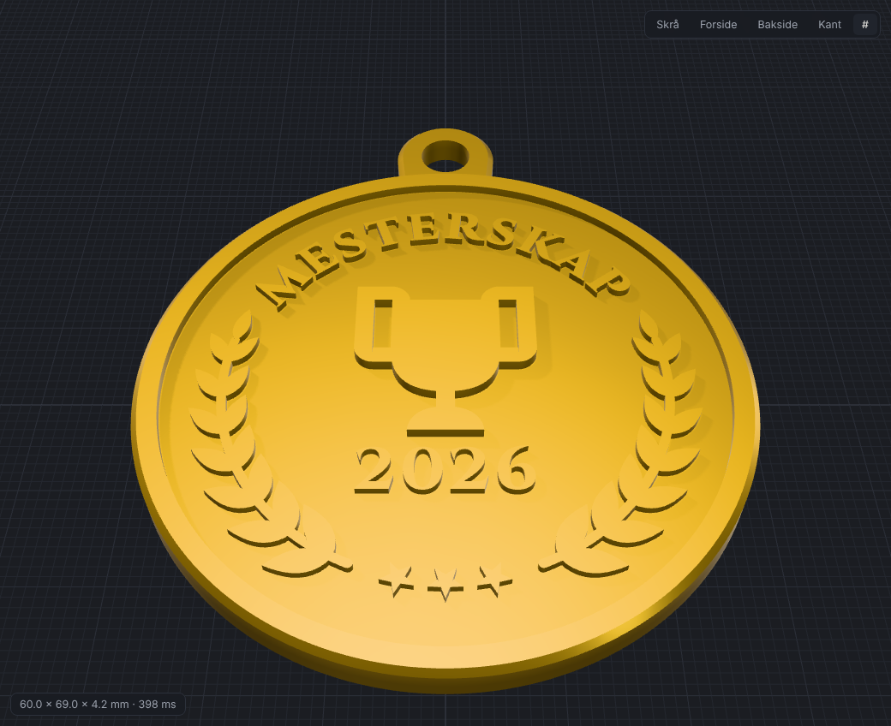
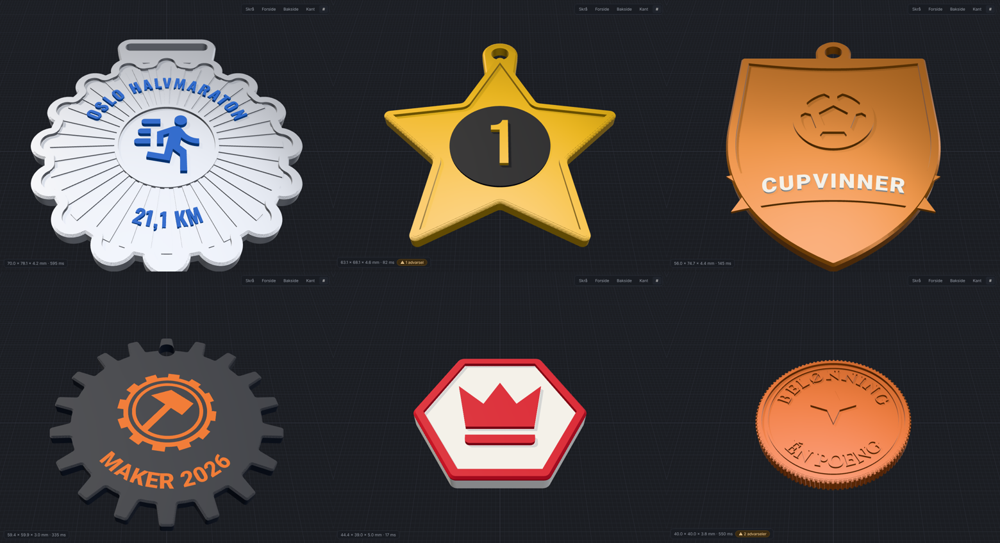

# 🏅 Medaljemaker

Et nettleserprogram for å designe medaljer for 3D-printing. Du velger form og størrelse, legger på tekst, ikoner og dekor, ser resultatet i 3D, og eksporterer en vanntett modell (STL eller flerfarge-3MF) som går rett inn i sliceren.





## Last ned skrivebordsappen

Ferdige programmer for **macOS** (`.dmg`), **Windows** (`.msi` / `-setup.exe`) og **Linux** (`.AppImage`, `.deb`, `.rpm`) ligger under [Releases](https://github.com/ahottesen/medal_app/releases).

Appen er ikke signert, så systemet advarer første gang du åpner den:
- **macOS:** høyreklikk på appen → «Åpne» → «Åpne». Får du beskjed om at appen er «skadet», kjør `xattr -cr /Applications/Medaljemaker.app` i Terminal.
- **Windows:** trykk «Mer info» → «Kjør likevel» hvis SmartScreen advarer.
- **Linux:** gjør AppImage-filen kjørbar (`chmod +x Medaljemaker*.AppImage`) og start den.

Ikonsøk og det store fontutvalget krever nett. Malene og fire innebygde fonter virker uten.

### Lage en ny versjon

1. Oppdater `version` i `package.json` (f.eks. `1.1.0`).
2. Lag en tagg og push den: `git tag v1.1.0 && git push origin v1.1.0`
3. GitHub Actions (`.github/workflows/desktop.yml`) bygger for alle tre systemene og lager et **utkast** under Releases. Se over utkastet og trykk «Publish».

På hver pull request bygges også alle tre versjonene. Filene ligger som «Artifacts» nederst på siden for kjøringen under **Actions**.

## Kom i gang (utvikling)

```bash
npm install
npm run dev        # åpne http://localhost:5173
```

Bygg en statisk versjon (kan legges på hvilken som helst webserver):

```bash
npm run build      # resultatet havner i dist/
npm run preview
```

### Skrivebordsappen lokalt

Krever [Rust](https://rustup.rs) og [systemavhengighetene til Tauri](https://v2.tauri.app/start/prerequisites/).

```bash
npm run desktop:dev     # åpner appen i eget vindu med automatisk oppdatering
npm run desktop:build   # lager installasjonsfiler i src-tauri/target/release/bundle/
```

### GitHub Pages

`.github/workflows/pages.yml` bygger og publiserer appen ved push til `main`. Første gang må du slå på Pages: **Settings → Pages → Source: GitHub Actions**.

## Funksjoner

**Form og størrelse**
- Sirkel, ellipse, mangekant, stjerne, rosett (bølget kant), tannhjul, skjold, hjerte, rektangel og banner
- Diameter/bredde, høyde, antall tagger/tenner/bølger, indre radius, avrundede hjørner, rotasjon
- Tykkelse på platen

**Kant**
- Opphøyd kant med valgfri bredde, høyde og farge, pluss en ekstra indre ring
- Fas eller avrundet ytterkant, og bunnfas mot «elefantfot»
- Riflet kant som på en mynt (antall, dybde, bredde)

**Oppheng**
- Øye med hull, båndspalte (forhåndsvalg for 12/22/25/30/38 mm bånd) eller hull i medaljen
- Plassering (vinkel), overlapp og egen tykkelse

**Elementer** – så mange du vil, i lag som kan flyttes opp og ned
- **Tekst**: rett (flere linjer, justering, linjeavstand) eller i bue øverst/nederst, med radius og spredning over en vinkel. Rundt 2000 fonter fra [Fontsource](https://fontsource.org) (Google Fonts m.fl.) med vekt og kursiv, eller last opp din egen TTF/OTF/WOFF. Fire fonter følger med og virker uten nett.
- **Ikoner**: søk i over 200 000 ikoner fra [Iconify](https://iconify.design) (Game Icons, Material, Font Awesome, Phosphor, Tabler …). Både fylte ikoner og strek-ikoner støttes. Du kan også laste opp din egen SVG.
- **Bilde**: PNG/JPG spores automatisk til konturer (terskel, inverter, utjevning). SVG brukes som vektor.
- **Laurbærkrans**: radius, grenhøyde, åpning, antall blader, bladform og -vinkel, parvis eller vekselvis
- **Gjentakelse på bue**: stjerner, prikker/perler, romber, hjerter osv. langs en bue eller rundt hele
- **Ring / bue**
- **Bakgrunnsmønster**: solstråler, konsentriske ringer, linjer, rutenett, bikube, prikker, bølger, sjakkbrett
- **Form**: alle konturformene over, f.eks. et buet banner bak teksten

For hvert element kan du velge:
- **Opphøyd**, **gravert**, **innlagt** (senket og fylt med en annen farge, så overflaten blir flat) eller **gjennom** (skåret helt ut)
- Høyde/dybde, starthøyde (for å stable, f.eks. tekst oppå et banner), farge
- Forside eller **bakside**. Baksiden speilvendes automatisk, så teksten leses riktig når medaljen snus.
- Posisjon, rotasjon, speilvending, «klipp til flaten»
- **Forsterk/slank** (gjør tynne streker tykkere) og **kun kontur**

Deler som stikker utenfor medaljen, eller som er løftet over ingenting, fylles automatisk ned til underlaget, så ingenting henger i lufta under printing.

**Farger og print**
- Opptil 8 fargespor med navn, farge og utseende (matt, silke, metallisk)
- Mål, volum, vekt og filamentlengde
- **Fargebytte-plan** for skrivere med én dyse: hvilket lag du skal bytte filament på, og varsel når fargene ligger på samme lag (da trengs AMS/MMU)
- Advarsler for detaljer som er tynnere enn dysa, elementer lavere enn ett lag, hull som går inn i medaljen osv.
- Lav, normal eller høy oppløsning på modellen

**Eksport**
- **3MF (flerfarge)**: én modell med én del per farge, med fargeinformasjon (Bambu Studio, OrcaSlicer, PrusaSlicer)
- **STL**: alt i én fil
- **STL per farge (ZIP)**
- **PNG**: bilde av forhåndsvisningen
- Prosjektet lagres automatisk i nettleseren, og kan også lagres og åpnes som `.medalje.json`

**Annet**
- Åtte ferdige maler: klassisk mesterskap, løpsmedalje, stjerne, skjold med banner, tannhjul, kjøleskapsmagnet, mynt og tom
- Dra elementene rett i 3D-visningen (Shift = 1 mm-steg), piltaster for finjustering
- Angre/gjør om (Ctrl+Z / Ctrl+Shift+Z), Delete for å slette, Ctrl+S for å lagre
- Visning fra skrått, forside, bakside og kant
- Magnetlomme på baksiden (f.eks. for kjøleskapsmagneter)

## Teknisk

- **Vite + React + TypeScript**
- **[manifold-3d](https://github.com/elalish/manifold)** (WASM) for 2D/3D-geometri. Det er samme motor som OpenSCAD bruker, og den gir garantert vanntette meshes. Geometrien bygges i en Web Worker, så brukergrensesnittet ikke fryser.
- **three.js** for 3D-visningen
- **opentype.js** for å lese fonter og gjøre tekst om til konturer
- **fflate** for ZIP/3MF
- **Tauri 2** (Rust) pakker webappen som skrivebordsprogram, med vanlige «Lagre som»-dialoger

```
src/
  model/      datamodell, standardverdier, maler, tilstand (angre/autolagring)
  geometry/   polygongeneratorer, 3D-bygging (manifold), worker, eksport
  assets/     fonter (Fontsource), ikoner (Iconify), SVG-tolking, tekstlayout, bildesporing
  ui/         3D-visning, paneler, ikon- og fontvelger
  platform.ts nettleser vs. skrivebordsapp (lagring, lenker)
src-tauri/    skrivebordsappen (Rust/Tauri): konfigurasjon, ikoner, tillatelser
scripts/
  test-build.ts   røyktest som bygger alle maler, former og elementtyper i Node
```

Kjør røyktesten av geometrien med `npm run test:geometry`.

## Lisenser for innhold

- Ikoner fra Iconify har lisensen til hver samling (vises i appen). Noen krever navngivelse, f.eks. Game Icons (CC BY 3.0).
- Fontene fra Fontsource / Google Fonts har åpne lisenser (stort sett SIL OFL).
